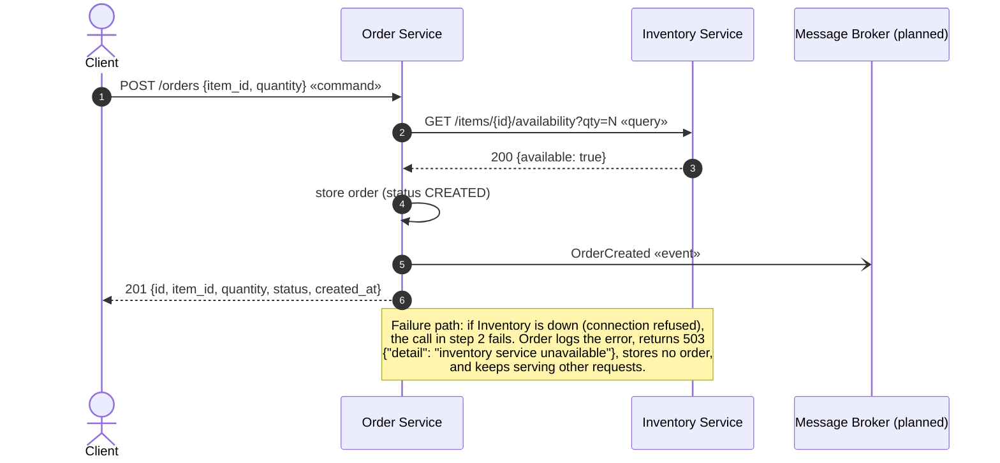
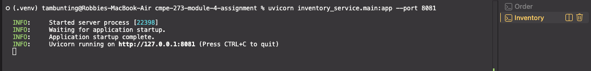
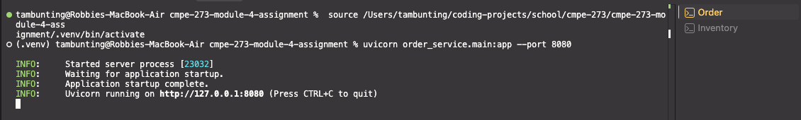
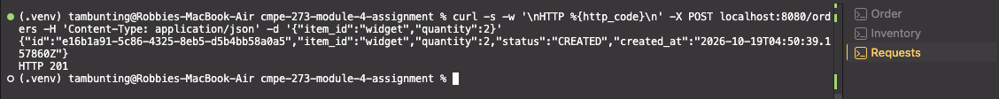
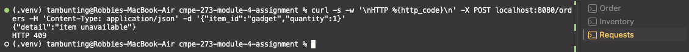
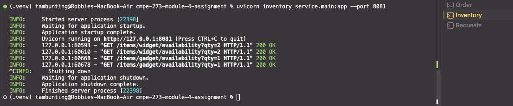
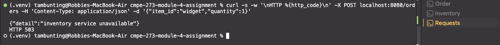
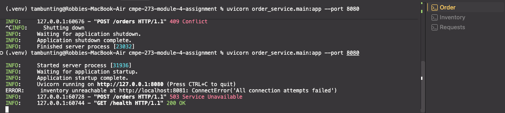

# Order and Inventory Services

A small distributed system made of two independent Python services. The **Order Service** accepts
requests to place orders and owns order records. Before accepting an order it asks the **Inventory
Service**, which owns stock levels, whether the requested quantity is available. The services
communicate over synchronous HTTP, keep their data in memory, and fail independently: if Inventory is
down, Order reports a clear error and keeps running. A third service, Notification, is designed to react
to an `OrderCreated` event through a message broker but is intentionally not implemented.

## Installing and running

Requires Python 3.11 or newer. Run these from the repository root.

```bash
python3 -m venv .venv
source .venv/bin/activate
pip install -r requirements.txt
```

Start each service in its own terminal, with the virtual environment activated.

```bash
# Terminal 1: Inventory Service on port 8081
uvicorn inventory_service.main:app --port 8081
```

```bash
# Terminal 2: Order Service on port 8080
uvicorn order_service.main:app --port 8080
```

Start Inventory first; Order only contacts it when an order is placed, so either order works.

Order reads the Inventory base URL from the `INVENTORY_URL` environment variable
(default `http://localhost:8081`):

```bash
INVENTORY_URL=http://localhost:8081 uvicorn order_service.main:app --port 8080
```

Check that both are up:

```bash
curl localhost:8081/health   # {"status":"ok"}
curl localhost:8080/health   # {"status":"ok"}
```

Stop a service with `Ctrl+C`. All data is held in memory and is reset on every start.
Inventory is seeded with `widget: 10`, `gadget: 0` and `gizmo: 3`.

## Architecture

### Component diagram


### Sequence diagram



**Legend:** solid arrows are implemented and synchronous. Dashed arrows and boxes (the message broker and
the Notification Service) are designed but not implemented. In the sequence diagram, the open-headed
arrow (`-)`) marks the asynchronous event; it is also designed but not implemented, and Order currently
only logs the event it would publish.

## Components and responsibilities

### Order Service (port 8080)

Accepts requests to place orders and keeps the order records. To decide whether an order can be
accepted, it asks the Inventory Service about availability. It never inspects stock itself.

| Endpoint | Purpose |
|---|---|
| `GET /health` | Liveness check. Returns `200 {"status": "ok"}`. |
| `POST /orders` | Create an order from `{"item_id": str, "quantity": int >= 1}`. |
| `GET /orders/{order_id}` | Fetch an order, or `404` if it does not exist. |

`POST /orders` calls Inventory with a 2-second timeout and maps the outcome to a response:

| Inventory outcome | Order response |
|---|---|
| Available | `201` with the order `{id, item_id, quantity, status: "CREATED", created_at}` |
| Not available | `409 {"detail": "item unavailable"}` (no order is stored) |
| Unknown item (`404`) | `404 {"detail": "unknown item"}` |
| Connection refused | `503 {"detail": "inventory service unavailable"}` |
| Timeout | `504 {"detail": "inventory service timed out"}` |
| Any other error | `502 {"detail": "bad response from inventory service"}` |

Every downstream failure is logged, and none of them stops the service. After a successful order
it logs an `OrderCreated` line (`[event] OrderCreated order_id=... (would publish to broker)`), which
stands in for publishing to a message broker.

### Inventory Service (port 8081)

Owns stock levels and answers availability questions. It has no knowledge of orders.

| Endpoint | Purpose |
|---|---|
| `GET /health` | Liveness check. Returns `200 {"status": "ok"}`. |
| `GET /items/{item_id}/availability?qty=N` | Report whether `N` units (default 1, minimum 1) are in stock. Returns `200 {"item_id", "requested", "available"}`, or `404 {"detail": "unknown item"}`. |

The availability endpoint is read-only: calling it never changes stock.

### Notification Service (designed, not implemented)

Would subscribe to `OrderCreated` events from a message broker and notify the customer. It is
shown in the architecture diagram, but no code exists for it. Order currently logs the event it
would publish.

## Data ownership

Each service is the only owner of its data and no service reads another service's data directly.
Other services get at the data only by calling the owner's API.

| Service | Owns | Storage |
|---|---|---|
| Order Service | Orders and their status | In-memory dictionary |
| Inventory Service | Stock levels per item | In-memory dictionary |
| Notification Service (not implemented) | Notification records and contact preferences | Not implemented |

For example, Order learns whether stock is available only by calling Inventory's availability
endpoint. It does not know how Inventory stores stock, and Inventory does not know that orders exist.

## Service boundaries

The system is split by business capability and data ownership: taking orders, managing stock and
notifying customers are separate capabilities, and each has its own data. This split gives each
service the following properties.

- **Independent change.** Inventory can change how it stores stock, or add fields to its response,
  without touching Order, as long as the availability endpoint keeps its contract.
- **Independent failure.** If Inventory is down, Order answers `503` and keeps serving health
  checks and order lookups (see the failure test below). Because the `OrderCreated` event is
  asynchronous, a missing Notification Service would not affect order creation at all.
- **Clear responsibility.** A question about stock is answered by Inventory and a question about an
  order is answered by Order, so there is one place to look and one owner for each rule.

Order depends on Inventory at order-creation time because it must know whether stock exists before it
accepts an order. That is a deliberate synchronous dependency, bounded by a 2-second timeout and an
explicit error response.

## Command / Query / Event

| Operation | Type | Reasoning |
|---|---|---|
| Check availability (`GET /items/{id}/availability`) | Query | It only reads stock and changes nothing, so it can safely be repeated or retried. |
| Create order (`POST /orders`) | Command | It asks the system to do something, namely create an order, and changes state, so it can be accepted or rejected. |
| Order was created (`OrderCreated`) | Event | It records a fact that has already happened, which other services such as Notification can react to without Order knowing about them. |

## Example requests

Output below was captured from a real run and is stored in [docs/demo-output.txt](docs/demo-output.txt).
The `HTTP <code>` line is printed by `curl` itself.

### Successful order

Order widget x2, which Inventory reports as available:

```
$ curl -s -w '\nHTTP %{http_code}\n' -X POST localhost:8080/orders -H 'Content-Type: application/json' -d '{"item_id":"widget","quantity":2}'
{"id":"cd521c37-ffea-4cce-b11a-8c67cacaf736","item_id":"widget","quantity":2,"status":"CREATED","created_at":"2026-10-19T04:36:51.161152Z"}
HTTP 201
```

The Order Service log for that request, including the event it would publish:

```
INFO:     HTTP Request: GET http://localhost:8081/items/widget/availability?qty=2 "HTTP/1.1 200 OK"
INFO:     [event] OrderCreated order_id=cd521c37-ffea-4cce-b11a-8c67cacaf736 item_id=widget (would publish to broker)
INFO:     127.0.0.1:60342 - "POST /orders HTTP/1.1" 201 Created
```

### Out-of-stock order

Gadget has no stock, so the order is rejected and nothing is stored:

```
$ curl -s -w '\nHTTP %{http_code}\n' -X POST localhost:8080/orders -H 'Content-Type: application/json' -d '{"item_id":"gadget","quantity":1}'
{"detail":"item unavailable"}
HTTP 409
```

## Failure test: Inventory down

This test shows that the Order Service reports a clear error, and keeps running, when the Inventory
Service is unavailable. The Inventory Service was stopped, an order was placed, and then the Order
Service's health endpoint was checked.

```
$ kill 11887   # stop Inventory Service
(Inventory Service stopped; port 8081 refuses connections)

$ curl -s -w '\nHTTP %{http_code}\n' -X POST localhost:8080/orders -H 'Content-Type: application/json' -d '{"item_id":"widget","quantity":1}'
{"detail":"inventory service unavailable"}
HTTP 503
```

The Order Service logged the failure and returned `503`. No `OrderCreated` event was logged, because
no order was created:

```
ERROR:     inventory unreachable at http://localhost:8081: ConnectError('All connection attempts failed')
INFO:     127.0.0.1:60350 - "POST /orders HTTP/1.1" 503 Service Unavailable
```

The Order Service is still healthy afterwards:

```
$ curl -s -w '\nHTTP %{http_code}\n' localhost:8080/health
{"status":"ok"}
HTTP 200
```

## Screenshots

Screenshots of the implementation running. Each one shows the command and its output.

### 1. Both services running

Inventory Service listening on port 8081:



Order Service listening on port 8080:



### 2. Successful order

`POST /orders` for 2 widgets returns `201` with the new order in status `CREATED`:



### 3. Out-of-stock order

`POST /orders` for a gadget, which has no stock, returns `409 item unavailable`:



### 4. Inventory Service stopped

The Inventory Service log shows the availability queries it answered (all `200 OK`), followed by a
clean shutdown with `Ctrl+C`:



### 5. Order rejected while Inventory is down

With Inventory stopped, `POST /orders` returns `503 inventory service unavailable`:



### 6. Order Service still running

The Order Service log shows the `ConnectError` being logged, the `503` response, and then a
`GET /health` answered with `200 OK` by the same running process:



## Known limitations

- **Check-then-create race.** Availability is a read, not a reservation. Two concurrent orders can
  both be told the last unit is available. A production system would use a `ReserveStock` command
  that atomically holds stock for the order.
- **`POST /orders` is not idempotent.** Retrying the same request creates a second order. A
  production system would accept an `Idempotency-Key` header and return the original result for repeats.
- **No retries or circuit breaker.** A failed Inventory call is reported immediately. Order does
  not retry, and it keeps calling Inventory even while Inventory is known to be down.
- **In-memory state is lost on restart.** Orders and stock levels are reset every time a service restarts.
- **Notification Service is not implemented.** The `OrderCreated` event is only logged, and no
  message broker is involved.

## Reflection

Question: Why are clear service boundaries and data ownership important in a distributed architecture?

TODO:
