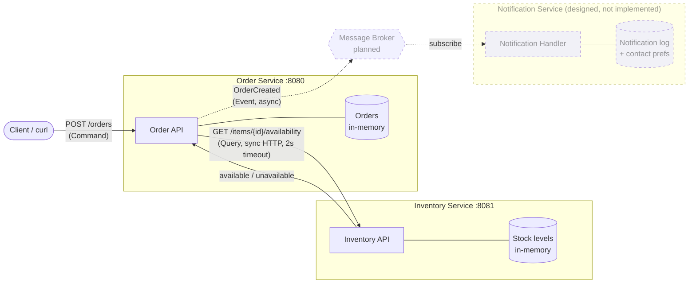
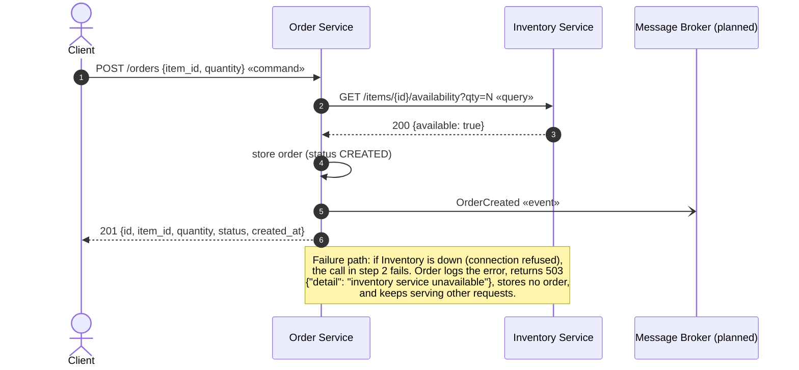

# Order and Inventory Services

A small distributed system made of two independent Python services. The **Order Service** accepts
requests to place orders and owns order records. Before accepting an order it asks the **Inventory
Service**, which owns stock levels, whether the requested quantity is available. The services
communicate over synchronous HTTP, keep their data in memory, and fail independently: if Inventory is
down, Order reports a clear error and keeps running. A third service, Notification, is designed to react
to an `OrderCreated` event through a message broker but is intentionally not implemented.

## Architecture

### Component diagram

### Sequence diagram

**Legend:** solid arrows are implemented and synchronous. Dashed arrows and boxes (the message broker and
the Notification Service) are designed but not implemented. In the sequence diagram, the open-headed
arrow (`-)`) marks the asynchronous event; it is also designed but not implemented, and Order currently
only logs the event it would publish.
